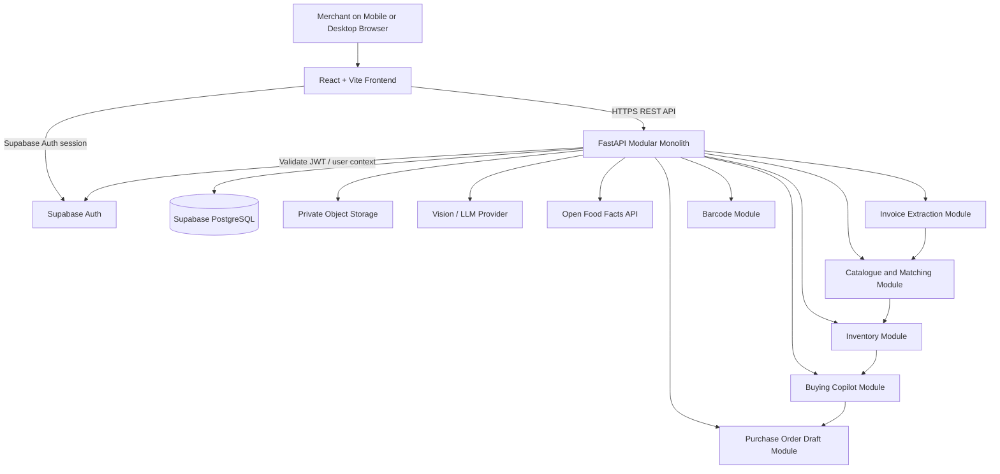
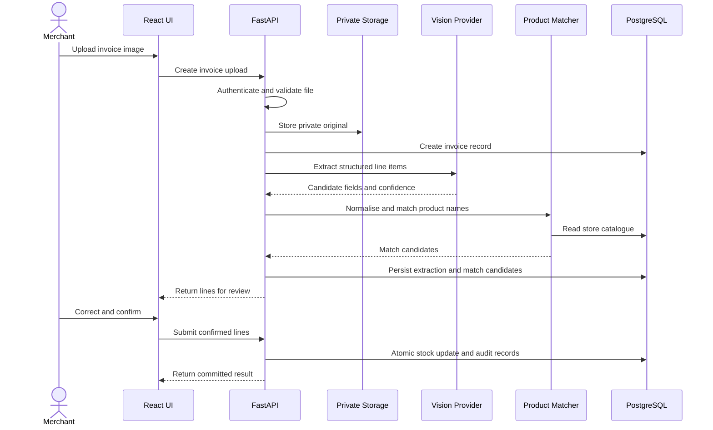

# ARCHITECTURE.md

## 1. Purpose and Scope

This document defines the implementation architecture for
**ShelfSaathi**, a mobile-first AI operating assistant for kirana stores
and small supermarkets.

Use the product documents as the source of truth:

- `PRD.md` defines product scope, user journeys, roles, and functional requirements.
- `DESIGN.md` defines visual design, UX behaviour, responsive layouts, and accessibility.
- `ARCHITECTURE.md` defines the technical structure used to implement those requirements.

Where the PRD or DESIGN does not specify a technical detail, this
document proposes a simple implementation default. Do not interpret an
implementation default as permission to add product functionality.

### 1.1 Product principles that affect architecture

- The merchant remains in control of inventory changes and purchasing
  decisions.
- AI extracts and interprets information; deterministic code performs
  calculations and stock updates.
- Invoice extraction must be reviewed and confirmed before stock is
  changed.
- Recommendations must explain the data and logic behind them.
- Do not claim real-time supplier availability without a real
  integration.
- Never fabricate product, sales, stock, supplier, or financial data.
- The MVP should be deployable and demonstrable without a complex
  distributed system.

## 2. Architecture Summary

Build a **single-page React application backed by a modular FastAPI
application**, with Supabase providing managed PostgreSQL and
authentication/storage capabilities where appropriate.

For the MVP, use a modular monolith rather than microservices.



### 2.1 MVP deployment shape

- Frontend: Vite-built static application deployed to Vercel.
- Backend: FastAPI application deployed to Render or an equivalent
  managed Python host.
- Database and authentication: Supabase.
- File storage: private Supabase Storage bucket, unless the chosen
  deployment setup requires a compatible private object store.
- AI: one configured vision-capable model provider behind a provider
  adapter.
- External product lookup: Open Food Facts where useful, with manual
  entry fallback.

Do not deploy each module separately. Modules are Python packages inside
one backend service.

## 3. Recommended Tech Stack

| Layer              | Recommendation                                                                              | Reason                                                                                              |
| ------------------ | ------------------------------------------------------------------------------------------- | --------------------------------------------------------------------------------------------------- |
| Frontend framework | React                                                                                       | Component-based UI suited to review tables, catalogue screens, and workflows                        |
| Frontend tooling   | Vite                                                                                        | Fast local development and straightforward static builds                                            |
| Language           | JavaScript                                                                                  | Keeps the MVP stack aligned with the existing project direction; TypeScript can be considered later |
| Styling            | Tailwind CSS                                                                                | Consistent responsive styling with a small implementation footprint                                 |
| Typography         | Outfit                                                                                      | Required by `DESIGN.md` as the sole product typeface                                                |
| API client         | Native `fetch` behind a small shared client module                                          | Avoids adding a data-fetching dependency before it is needed                                        |
| Backend framework  | FastAPI                                                                                     | Typed request/response validation, clear routing, and convenient API documentation                  |
| Backend language   | Python                                                                                      | Strong ecosystem for document processing, AI APIs, and data matching                                |
| Request validation | Pydantic, included with FastAPI                                                             | Validates external and internal API payloads                                                        |
| Database           | Supabase PostgreSQL                                                                         | Managed relational database with transactions and constraints                                       |
| Authentication     | Supabase Auth                                                                               | Avoids implementing password storage and session lifecycle from scratch                             |
| Database access    | SQLAlchemy 2.x or psycopg with a small repository layer                                     | Keeps SQL and transaction boundaries out of route handlers                                          |
| Migrations         | Alembic                                                                                     | Versioned, reviewable schema changes                                                                |
| Image processing   | Pillow, only where needed                                                                   | Image resizing, format validation, and preprocessing                                                |
| Invoice AI         | Google Gemini Vision API (`gemini-1.5-flash`), accessed through an adapter                  | Extracts invoice line items from images; adapter keeps provider swappable                            |
| Product matching   | RapidFuzz plus deterministic normalisation rules                                            | Efficient fuzzy matching of invoice descriptions against the store catalogue                        |
| Barcode scanning   | ZXing-compatible browser library                                                            | Reads manufacturer barcodes using the device camera where supported                                 |
| Barcode generation | JsBarcode on the frontend or a backend library if server-generated output is required       | Generates common retail barcode formats for labels                                                  |
| PDF labels         | Browser print layout or a PDF-generation library if reliable downloadable PDFs are required | Keeps label generation simple and printable                                                         |
| Frontend hosting   | Vercel                                                                                      | Convenient deployment for a Vite static frontend                                                    |
| Backend hosting    | Render                                                                                      | Straightforward deployment for a Python web service                                                 |
| Testing            | Pytest, HTTPX, and Vitest/React Testing Library                                             | Covers backend rules, API contracts, and frontend workflows                                         |
| Observability      | Structured application logs and host-provided logs initially                                | Enough for an MVP without operating a monitoring stack                                              |

### 3.1 Dependency rules

- Prefer standard library capabilities and dependencies already
  included by the framework.
- Add a package only when it solves a real requirement.
- Do not add Redux, a message broker, a vector database, Kubernetes,
  or a microservice framework for the MVP.
- Do not add an agent framework simply to call an LLM. Use explicit
  application functions and provider adapters.
- Keep the AI provider and database access behind small interfaces so
  they can be changed later.

## 4. Frontend Architecture

### 4.1 Responsibilities

The frontend is responsible for:

- Authentication screens and session-aware navigation.
- Merchant workflows and form state.
- Invoice image capture/upload and extraction review.
- Product catalogue and inventory views.
- Barcode scanning and label preview/printing.
- Displaying explainable reorder suggestions.
- Creating and editing purchase-order drafts.
- Loading, empty, success, validation, permission, and error states from `DESIGN.md`.
- Responsive layouts and accessible interactions.

The frontend is **not** the authority for stock quantities, reorder
calculations, role permissions, or final persistence. The backend must
validate and enforce these.

### 4.2 Suggested folder structure

```text
frontend/
├── public/
│   ├── fonts/
│   │   └── outfit/
│   └── assets/
├── src/
│   ├── app/
│   │   ├── App.jsx
│   │   ├── router.jsx
│   │   └── providers.jsx
│   ├── components/
│   │   ├── ui/
│   │   ├── layout/
│   │   ├── feedback/
│   │   └── forms/
│   ├── features/
│   │   ├── auth/
│   │   ├── dashboard/
│   │   ├── invoices/
│   │   ├── catalogue/
│   │   ├── inventory/
│   │   ├── barcodes/
│   │   ├── buying-copilot/
│   │   └── purchase-orders/
│   ├── hooks/
│   ├── lib/
│   │   ├── api-client.js
│   │   ├── supabase-client.js
│   │   ├── formatting.js
│   │   └── validation.js
│   ├── styles/
│   │   └── index.css
│   ├── test/
│   └── main.jsx
├── .env.example
├── package.json
└── vite.config.js
```

Keep feature-specific components, API functions, and state close to
their feature. Promote a component into `components/ui` only when it is
genuinely reusable.

### 4.3 Frontend data flow

- Use Supabase Auth on the client to sign in and manage the user's
  session.
- Send the access token to FastAPI as a bearer token for protected API
  requests.
- Centralise API requests in `api-client.js`; do not scatter raw
  `fetch` calls across components.
- Parse API errors into a consistent frontend error shape.
- Keep temporary form and review state in the relevant feature.
- Treat the backend response as the source of truth after a successful
  mutation.
- Do not optimistically show a stock update as final before the
  backend confirms it.
- Avoid introducing global state management until real shared-state
  needs appear.

### 4.4 Frontend route groups

Use routes only for pages and workflows defined by `PRD.md`. The likely
MVP groups are:

- Authentication.
- Store overview.
- Invoice upload and review.
- Product catalogue and inventory.
- Barcode scanning and label printing.
- Buying Copilot suggestions.
- Purchase-order drafts.

If a feature is designated as mock or roadmap in the PRD, label it
clearly in the interface and do not represent simulated behaviour as a
live integration.

## 5. Backend Architecture

### 5.1 Modular monolith

FastAPI runs as one deployable application. Separate business domains
into modules, but do not split them into network services.

Suggested backend structure:

```text
backend/
├── app/
│   ├── main.py
│   ├── core/
│   │   ├── config.py
│   │   ├── logging.py
│   │   ├── errors.py
│   │   └── security.py
│   ├── api/
│   │   ├── router.py
│   │   └── dependencies.py
│   ├── modules/
│   │   ├── auth/
│   │   ├── stores/
│   │   ├── catalogue/
│   │   ├── invoices/
│   │   ├── inventory/
│   │   ├── barcodes/
│   │   ├── buying_copilot/
│   │   └── purchase_orders/
│   ├── integrations/
│   │   ├── supabase_auth.py
│   │   ├── storage.py
│   │   ├── vision_provider.py
│   │   └── open_food_facts.py
│   ├── db/
│   │   ├── session.py
│   │   ├── models/
│   │   ├── repositories/
│   │   └── migrations/
│   ├── schemas/
│   └── tests/
├── alembic.ini
├── pyproject.toml
├── .env.example
└── README.md
```

The exact module names may be adjusted to match `PRD.md`, but keep route
handlers, business rules, persistence, and external integrations
separate.

### 5.2 Module responsibilities

| Module            | Responsibilities                                                                               |
| ----------------- | ---------------------------------------------------------------------------------------------- |
| `auth`            | Validate user identity, resolve store membership, enforce access dependencies                  |
| `stores`          | Store profile and membership data, where required by the PRD                                   |
| `catalogue`       | Product records, units, pack sizes, barcodes, normalisation, and product matching              |
| `invoices`        | Upload metadata, extraction jobs/status, extracted line items, confidence and review state     |
| `inventory`       | Confirmed stock changes, stock movements, quantity validation, and transaction handling        |
| `barcodes`        | Barcode lookup, validation, generated identifiers where needed, and label data                 |
| `buying_copilot`  | Deterministic reorder calculations and structured explanations                                 |
| `purchase_orders` | Editable draft creation from approved recommendations; no automatic order placement in the MVP |
| `integrations`    | Provider-specific code for AI, authentication, storage, and external product lookup            |

### 5.3 Layering rules

Use this call direction:

```text
API route
   ↓
Application/service function
   ↓
Domain rules and validation
   ↓
Repository / transaction
   ↓
PostgreSQL
```

External provider calls go through integration adapters.

- Route handlers should validate input, call a service, and return a
  response.
- Business rules must not live in React components or route handlers.
- Repository functions should focus on persistence, not business
  decisions.
- Keep transactions explicit around stock changes and related records.
- Do not call the AI provider while holding a database transaction
  open.

## 6. Data Model and Database Interaction

The final schema must follow the entities and fields in `PRD.md`. The
following is a proposed minimum model to support the MVP; it should be
reconciled with the PRD before migrations are finalised.

### 6.1 Proposed entities

| Entity                  | Purpose                                                                                              |
| ----------------------- | ---------------------------------------------------------------------------------------------------- |
| `stores`                | Retail store or merchant workspace                                                                   |
| `store_members`         | Associates authenticated users with stores and roles, if multiple users per store are in scope       |
| `products`              | Store catalogue, product identity, unit, pack size, and barcode                                      |
| `inventory`             | Current on-hand quantity and any required stock summary fields                                       |
| `stock_movements`       | Auditable record of additions, reductions, and corrections                                           |
| `invoices`              | Uploaded invoice metadata, processing status, and review status                                      |
| `invoice_lines`         | Extracted line items, matched product, quantities, prices, confidence, and review decisions          |
| `purchase_order_drafts` | Editable draft orders created from merchant-approved suggestions                                     |
| `purchase_order_lines`  | Products and quantities in a draft                                                                   |
| `sales_records`         | Imported or explicitly entered product-level sales history, if required for the recommendation logic |
| `suppliers`             | Seeded or verified supplier information only when the relevant feature is in scope                   |

Avoid adding tables for roadmap-only modules until those modules are
approved for implementation.

### 6.2 Database rules

- Use UUID primary keys for application entities unless an existing
  schema establishes another convention.
- Include `created_at` and `updated_at` where lifecycle tracking is
  useful.
- Store quantities and money using appropriate numeric/decimal types,
  not floating-point types.
- Store timestamps consistently in UTC; format them for the user in
  the frontend.
- Use foreign keys, `NOT NULL`, uniqueness, and check constraints to
  enforce invariants.
- Add indexes for frequent lookups, especially store ownership,
  product barcode, invoice status, and foreign-key columns.
- Scope all store-owned records to a store identifier.
- Avoid duplicating values that can be derived reliably, except where
  a documented performance need exists.
- Preserve historical stock movements rather than relying only on
  overwriting a current quantity.

### 6.3 Inventory integrity

A confirmed invoice must update stock and record its stock movements
atomically.

Expected flow:

1. Validate that the invoice belongs to the active store.
2. Validate the review status and all confirmed line items.
3. Resolve each line to an existing product or an explicitly confirmed new product.
4. Begin a database transaction.
5. Insert the relevant stock movement records.
6. Update current inventory quantities.
7. Mark the invoice as confirmed/processed.
8. Commit the transaction.
9. Return the committed state to the frontend.

If any database operation fails, roll back the entire stock update.
Repeated confirmation requests must not apply the same invoice twice.
Use an idempotency key or a unique processing constraint to enforce
this.

Do not update inventory during extraction or matching. Stock changes
occur only after explicit merchant confirmation.

### 6.4 Database access strategy

Use one supported database access pattern consistently. For a
maintainable Python application, SQLAlchemy 2.x with explicit
transactions and Alembic migrations is the recommended default. A small
psycopg-based repository layer is also acceptable if chosen at project
start; do not use both patterns inconsistently.

Use a server-side database connection from FastAPI. Keep privileged
database credentials on the backend only. If Supabase Row Level Security
is used, define and test policies rather than assuming that the presence
of RLS automatically makes access safe.

## 7. Authentication and Authorization

### 7.1 Authentication

- Use Supabase Auth for sign-in, sign-out, and session management.
- The frontend obtains an access token through the supported Supabase
  client.
- Protected API requests include
  `Authorization: Bearer <access_token>`.
- FastAPI validates the token's signature and relevant claims using
  the correct Supabase JWT verification configuration.
- Verify issuer, audience where applicable, expiry, and signature. Do
  not trust user IDs sent in request bodies as proof of identity.
- Never put the Supabase service-role key or other privileged
  credentials in frontend environment variables.
- Treat authentication and store authorisation as separate checks.

### 7.2 Authorization

Every protected request must establish:

1. Who the caller is.
2. Which store the caller is acting on.
3. Whether the caller has permission to perform the requested action.
4. Whether the target resource belongs to that store.

For the MVP, multi-user staff permissions are implemented using explicit store
membership and role checks. Supported roles are `owner` (full store administration,
member management, stock confirmation) and `staff` (invoice capture, line review,
barcode lookup, label printing, and draft creation).

### 7.3 Store isolation

- Derive the authenticated user from the validated token.
- Resolve store membership on the server.
- Verify store ownership/membership for every store-scoped read and
  write.
- Never rely on a `store_id` supplied by the browser without checking
  membership.
- Add database constraints and, where applicable, RLS policies as
  defence in depth.
- Test cross-store access attempts explicitly.

## 8. API Architecture

### 8.1 API conventions

- Use REST endpoints under `/api/v1`.
- Use JSON for normal request and response bodies.
- Use multipart upload endpoints for invoice images where appropriate.
- Define request and response schemas with Pydantic.
- Use consistent plural resource names and HTTP semantics.
- Return appropriate status codes and a stable error response format.
- Keep OpenAPI documentation enabled in development; restrict or
  disable public API documentation in production if the deployment
  requires it.
- Version breaking API changes deliberately.

### 8.2 Proposed MVP endpoint groups

These are architectural endpoint groups, not a substitute for the exact
endpoint list in `PRD.md`.

| Group                           | Example responsibilities                                                             |
| ------------------------------- | ------------------------------------------------------------------------------------ |
| `/api/v1/me`                    | Return current authenticated user and authorised store context                       |
| `/api/v1/stores`                | Read or update the current store profile, if in scope                                |
| `/api/v1/products`              | List, create, update, and search catalogue products                                  |
| `/api/v1/invoices`              | Upload invoice, list invoice records, read extraction result, confirm reviewed lines |
| `/api/v1/inventory`             | Read stock summaries and stock movement history                                      |
| `/api/v1/barcodes`              | Look up barcode information and provide label data                                   |
| `/api/v1/reorder-suggestions`   | Return computed suggestions with their input data and explanations                   |
| `/api/v1/purchase-order-drafts` | Create, edit, retrieve, and delete draft purchase orders                             |

Use the actual PRD vocabulary and required operations when implementing
endpoints. Do not expose endpoints for features that are only mock or
roadmap.

### 8.3 Error response format

Use a consistent structure with:

- A stable machine-readable error code.
- A human-readable message safe to show to the user.
- Optional field-level validation details.
- A request/correlation identifier where useful.

Do not return exception traces, SQL, provider responses containing
secrets, or internal implementation details to clients.

### 8.4 API reliability

- Validate file type, size, and request shape before expensive
  processing.
- Apply request timeouts to external services.
- Use bounded retries only for transient failures and only where
  retrying is safe.
- Use idempotency protection for invoice confirmation and other
  operations that must not run twice.
- Paginate catalogue and history endpoints when lists can grow.
- Do not create asynchronous job infrastructure until processing
  duration or traffic justifies it. For the MVP, a clear synchronous
  flow is acceptable if it fits hosting limits; otherwise use a
  persisted processing status and a simple background task mechanism
  supported by the host.

## 9. Invoice Extraction and Product Matching

### 9.1 Processing flow



### 9.2 AI output requirements

- Ask the model for structured fields, not free-form prose.
- Validate all model output against a Pydantic schema.
- Represent uncertain or missing values as unknown/null rather than
  guessing.
- Store extraction confidence where the provider or application can
  meaningfully supply it.
- Treat model-generated product matches as candidates until confirmed
  by deterministic matching rules or the merchant.
- Never let AI output directly execute SQL or change inventory.
- Keep the original image private and apply retention rules approved
  for the product.
- Do not log full invoice contents or images by default.

### 9.3 Matching strategy

Use a deterministic pipeline:

1. Normalise whitespace, punctuation, case, and common unit representations.
2. Match exact barcode or trusted product identifiers first.
3. Match exact normalised product names next.
4. Use RapidFuzz to rank approximate name matches.
5. Apply a conservative acceptance threshold and return ambiguous candidates for review.
6. Let the merchant correct or create a product.
7. Store confirmed mappings where useful to improve future matching.

Thresholds must be tuned against real invoices. Do not treat fuzzy
similarity as proof that two products are identical. Pack size, unit,
brand, and variant differences must be considered.

### 9.4 Provider abstraction

Expose a small internal interface for invoice extraction. The
application should depend on the interface, not directly on a
vendor-specific SDK response. Provider-specific request formatting,
retries, and response parsing belong in
`integrations/vision_provider.py`.

Use one provider for the MVP. Add a second provider only if there is a
concrete reliability, cost, or quality requirement.

## 10. Inventory and Buying Copilot

### 10.1 Deterministic business logic

Use ordinary Python functions for:

- Stock quantity arithmetic.
- Unit and pack-size conversions where explicitly supported.
- Reorder thresholds and suggested quantities.
- Barcode validation and generation rules.
- Purchase-order draft totals.

These calculations must be testable without an LLM.

### 10.2 Reorder suggestions

A suggestion should expose the inputs and reasoning available to the
system, such as:

- Current on-hand quantity.
- Sales rate or the source of the demand estimate.
- Estimated days of stock remaining, if sufficient data exists.
- Configured minimum or target stock level.
- Suggested reorder quantity and its calculation basis.

If reliable product-level sales history is not available, use only the
limited sample or stock data explicitly designated for the MVP demo.
Label sample-data recommendations as sample data. Do not imply that
payment totals alone reveal units sold.

### 10.3 Human approval boundary

- Suggestions are advisory.
- The merchant can review and edit the proposed quantity.
- The application may create an editable purchase-order draft after
  the merchant's action.
- The MVP must not automatically send an order, place a purchase, or
  claim a supplier accepted an order.
- Any future external ordering integration requires explicit approval,
  provider integration, and a separate security review.

## 11. Barcode and Product Lookup Architecture

### 11.1 Barcode scanning

- Use a browser-compatible ZXing implementation for camera scanning.
- Request camera permission only when the user starts scanning.
- Provide manual barcode entry as a fallback.
- Handle unsupported cameras, denied permissions, and unreadable codes
  without blocking the rest of the workflow.
- Validate barcode formats before saving.
- Use manufacturer barcodes when available; generate labels only for
  products that need them.

### 11.2 Label generation

- Generate label content from confirmed product data.
- Keep barcode values and human-readable product labels consistent.
- Provide a print-friendly layout or downloadable PDF appropriate to
  the PRD.
- Test print margins, label dimensions, and browser print behaviour.
- Do not claim a barcode is registered with an external authority
  unless that has been verified.

### 11.3 External product lookup

Open Food Facts may be queried to enrich barcode lookups where data is
available. It is an optional lookup source, not the authoritative source
for a store's price, stock, or purchase history.

- Handle no match, rate limiting, and unavailable service.
- Cache responses only in a way consistent with the provider's terms
  and data freshness needs.
- Fall back to manual or AI-assisted entry.
- Never overwrite confirmed store-specific fields with external data
  without the merchant's approval.

## 12. External Services

| Service                 | MVP use                                    | Boundary and fallback                                                               |
| ----------------------- | ------------------------------------------ | ----------------------------------------------------------------------------------- |
| Supabase Auth           | User authentication and session issuance   | FastAPI independently validates access tokens                                       |
| Supabase PostgreSQL     | Application data                           | Server-side access only; migrations are version controlled                          |
| Supabase Storage        | Private invoice image storage, if selected | No public invoice bucket; validate access and file metadata                         |
| Google Gemini Vision   | Invoice field extraction                   | Google Gemini API (`gemini-1.5-flash`) through adapter; review required for all lines |
| Open Food Facts         | Optional barcode/product metadata lookup   | Missing data is normal; provide manual fallback                                     |
| Vercel                  | Frontend hosting                           | No secrets in client-exposed environment variables                                  |
| Render                  | Backend hosting                            | Store secrets in managed environment settings; configure health checks and timeouts |

Do not integrate supplier networks, WhatsApp sending, Instagram
publishing, billing/POS systems, or voice-agent services in the MVP
unless the PRD explicitly promotes them from mock/roadmap to required
scope.

## 13. AI Architecture and Boundaries

AI is needed for invoice extraction and may support product-name
interpretation or natural-language assistance if those capabilities are
included in the approved MVP. It is not required for deterministic
inventory arithmetic.

### AI should

- Extract candidate invoice fields.
- Help interpret inconsistent product descriptions.
- Produce structured, bounded outputs for application review.
- Explain a recommendation using data already supplied by the
  application, when an explanation model is explicitly needed.

### AI must not

- Execute database operations directly.
- Decide whether a user is authorised.
- Invent stock levels, sales history, prices, supplier availability,
  or delivery promises.
- Confirm invoice lines on behalf of the merchant.
- Automatically place purchase orders.
- Override deterministic calculations.
- Receive secrets or unnecessary personal/store data in prompts.

### Reliability controls

- Validate provider output.
- Set request timeouts and token/output limits.
- Handle provider unavailability and malformed responses.
- Use bounded retries for transient failures.
- Store enough status and error metadata to diagnose processing
  without logging sensitive document contents.
- Keep prompts and response schemas versioned where practical.
- Test with representative clear, blurry, incomplete, and varied
  invoice formats.

Do not introduce autonomous agents, tool-calling loops, vector
databases, or a separate AI orchestration service for the MVP.

## 14. Environment Configuration

Keep configuration outside source code.

### 14.1 Frontend environment

Only non-secret browser configuration may use Vite's `VITE_` prefix. For
example:

- Public Supabase project URL.
- Supabase publishable/anon key.
- Public API base URL.

Never place a service-role key, database password, AI API key, or
private storage credential in a `VITE_` variable.

### 14.2 Backend environment

Use environment variables or the hosting provider's secret manager
for:

- Runtime environment.
- API host/port settings.
- Database connection URL.
- Supabase project URL and JWT verification settings.
- Supabase service-role key, only if the backend requires privileged Supabase operations.
- Private storage configuration.
- Selected AI provider and API key.
- External product lookup configuration, if needed.
- CORS allowed origins.
- Upload size and timeout limits.
- Logging level.

Document variable names and safe placeholders in `.env.example`. Never
commit real secrets.

### 14.3 Configuration rules

- Validate required configuration at application startup.
- Fail fast with a clear server-side error if a required secret or
  setting is missing.
- Keep development, test, staging, and production configurations
  separate.
- Do not use production data in automated tests.
- Rotate exposed credentials promptly.
- Keep a documented procedure for changing AI providers and database
  credentials.

## 15. Error Handling and Observability

### 15.1 Error categories

Handle at least:

- Invalid request or validation error.
- Unauthenticated request.
- Forbidden or cross-store access.
- Missing resource.
- Duplicate or already-processed operation.
- Unsupported or oversized upload.
- AI provider timeout, failure, or malformed output.
- External lookup timeout or rate limit.
- Database conflict or failure.
- Unexpected server error.

### 15.2 Error handling rules

- Convert known errors into consistent API responses.
- Log unexpected exceptions with a correlation identifier.
- Return safe, actionable messages to the frontend.
- Do not silently convert extraction failures into empty successful
  results.
- Preserve uploaded invoice metadata and processing status when
  practical so the user can recover or retry.
- Do not retry non-idempotent database mutations blindly.
- Keep error handling separate from business logic.

### 15.3 Logging

Log operational events such as:

- Request correlation ID, route, status, and duration.
- Invoice processing status and duration.
- External provider name, latency, and failure category.
- Database operation failures.
- Authentication and authorisation failures, without logging access tokens.

Do not log passwords, bearer tokens, service keys, complete invoice
images, or full sensitive document contents.

For the MVP, use structured logs and the hosting provider's monitoring.
Add external monitoring only when operational needs justify it.

## 16. Security Boundaries

### 16.1 Trust boundaries

1.  **Browser to API:** all inputs are untrusted and must be validated.
2.  **Browser to Supabase Auth:** use supported authentication flows;
    never expose privileged keys.
3.  **API to database:** use server-side credentials with least
    privilege and controlled access.
4.  **API to AI provider:** send only necessary data; validate all
    returned content.
5.  **API to file storage:** keep invoice files private and check
    authorisation before access.
6.  **API to external product services:** treat responses as untrusted
    external data.

### 16.2 Required protections

- HTTPS in deployed environments.
- Strict CORS allowlist for known frontend origins.
- Server-side input validation for all endpoints.
- File upload size and content-type limits; inspect file signatures
  where practical.
- Safe image decoding and preprocessing.
- Rate limiting or abuse controls for expensive endpoints, especially
  AI extraction.
- Authentication and store-level authorisation on every protected
  resource.
- Parameterised SQL or ORM-generated queries.
- Secrets held only in server-side configuration.
- Dependency updates and vulnerability checks as part of maintenance.
- Private storage and short-lived access URLs where direct file access
  is required.
- Audit records for stock changes and invoice confirmation.
- Idempotency for operations that could duplicate stock changes.
- Appropriate retention and deletion rules for uploaded documents.

### 16.3 Security non-goals for the MVP

Do not build a custom identity provider, a custom encryption framework,
or a complex policy engine. Use established services and framework
controls correctly. Reassess security needs before adding staff
permissions, supplier integrations, financial integrations, or automated
ordering.

## 17. Testing Strategy

### 17.1 Backend tests

Use Pytest and HTTPX for:

- Request/response schema validation.
- Authentication and unauthorised access.
- Store isolation and permission checks.
- Product creation and matching.
- Invoice extraction response validation.
- Invoice review and confirmation.
- Atomic inventory updates and rollback behaviour.
- Duplicate confirmation prevention.
- Barcode validation.
- Reorder calculation correctness.
- Purchase-order draft creation and editing.
- External provider timeouts and malformed responses.

Mock AI and external HTTP services in normal automated tests. Keep a
small, explicitly controlled integration test suite for real external
services if needed.

### 17.2 Frontend tests

Use Vitest and React Testing Library for:

- Form validation.
- Invoice review and correction.
- Loading, empty, success, and error states.
- API error display.
- Camera permission denial and manual barcode fallback.
- Reorder explanation display.
- Purchase-order draft editing.
- Keyboard interaction for important controls.

### 17.3 End-to-end tests

Use a browser automation tool such as Playwright if the team needs
reliable end-to-end coverage. Prioritise the main journey:

1.  Sign in.
2.  Upload a test invoice.
3.  Review and correct extracted lines.
4.  Confirm the invoice.
5.  Verify inventory and stock movement results.
6.  Scan or enter a barcode and produce a label.
7.  View a reorder suggestion and its explanation.
8.  Create or edit a purchase-order draft.

Use test accounts, synthetic invoices, and isolated test data.

### 17.4 Quality gates

Before merging:

- Lint and build the frontend.
- Run backend unit and API tests.
- Run database migrations against a clean test database.
- Check for committed secrets.
- Verify the core workflow manually or through end-to-end tests.
- Test a narrow viewport and keyboard navigation.
- Verify that no stock mutation occurs before confirmation.

## 18. Deployment Approach

### 18.1 Environments

Keep at least:

- Local development.
- Production.

A staging environment is recommended before onboarding pilot merchants,
especially when invoice processing or database migrations change.

### 18.2 Deployment flow

1.  Changes are committed to version control.
2.  Automated checks run for frontend and backend.
3.  Database migrations are reviewed and tested.
4.  Frontend build is deployed to Vercel.
5.  FastAPI service is deployed to Render.
6.  Runtime secrets and CORS settings are configured in the hosting
    dashboards.
7.  Health checks and critical workflows are verified.
8.  Rollback instructions are retained for application and schema
    changes.

### 18.3 Database migrations

- Keep migrations in version control.
- Never rely on ad hoc production schema changes.
- Back up important data before risky migrations.
- Prefer backward-compatible changes where possible.
- Deploy schema changes in a sequence compatible with the currently
  running application.
- Test migration and rollback or recovery procedures before production
  changes.

### 18.4 Health checks

Provide a lightweight health endpoint that confirms the application
process is responsive. If a readiness check verifies external
dependencies, avoid exposing internal details or making the endpoint
unnecessarily expensive.

### 18.5 Backups and recovery

- Confirm the selected Supabase plan's backup and recovery
  capabilities before relying on them.
- Establish a manual export/recovery procedure suitable for the pilot.
- Define who can access backups and how credentials are protected.
- Test restoration before real merchant data becomes operationally
  important.
- Do not assume that a hosting provider's existence alone guarantees a
  tested recovery plan.

## 19. MVP Versus Future Scalability

### MVP: implement now

- One React/Vite frontend.
- One FastAPI modular monolith.
- One Supabase PostgreSQL project.
- Supabase Auth.
- Private invoice storage.
- One AI vision provider behind an adapter.
- Deterministic catalogue matching and stock arithmetic.
- Merchant-reviewed invoice confirmation.
- Barcode scanning and label generation.
- Explainable reorder suggestions using only available, labelled data.
- Editable purchase-order drafts with no automatic order placement.
- Basic structured logs, automated tests, and a documented deployment
  process.

### Later, only when justified

- Background job queue for long-running or high-volume invoice
  processing.
- Dedicated worker process for document extraction.
- Provider fallback or model routing based on measured quality,
  latency, and cost.
- Billing/POS import connectors for reliable product-level sales
  history.
- Real supplier integrations and WhatsApp ordering with explicit
  approval controls.
- Multi-store and staff permission enhancements if required by actual
  customers.
- Advanced observability and alerting.
- Caching for measured database or external API bottlenecks.
- Separate services only when deployment independence, load, or team
  ownership provides a clear benefit.

Do not build future infrastructure speculatively. Use metrics and pilot
feedback to justify complexity.

## 20. Architecture Decisions and Assumptions

| Decision             | Default                                       | Reason / qualification                                           |
| -------------------- | --------------------------------------------- | ---------------------------------------------------------------- |
| Application shape    | Modular monolith                              | Simplest reliable MVP architecture                               |
| Frontend             | React + Vite + JavaScript + Tailwind CSS      | Aligns with the current project direction                        |
| Typeface             | Outfit only                                   | Required by `DESIGN.md`                                          |
| Backend              | FastAPI + Python                              | Suitable for REST APIs, document processing, and AI integrations |
| Database             | Supabase PostgreSQL                           | Managed relational persistence                                   |
| Authentication       | Supabase Auth                                 | Avoids custom credential management                              |
| AI                   | Google Gemini API (`gemini-1.5-flash`)        | Approved vision-capable provider behind an adapter               |
| Roles / Permissions  | Multi-user: `owner` and `staff`               | Scoped per store via `store_members` table                       |
| Matching             | Deterministic normalisation + RapidFuzz       | Makes candidate matching inspectable and testable                |
| Stock calculations   | Deterministic backend logic                   | Inventory arithmetic must not depend on LLM output               |
| Invoice confirmation | Merchant-approved and transactional           | Prevents unreviewed or duplicate stock changes                   |
| Purchase orders      | Draft-only                                    | No automatic purchasing in the MVP                               |
| Hosting              | Vercel frontend + Render backend              | Simple managed deployment path                                   |
| Supplier data        | Seeded/mock where explicitly allowed          | Do not claim real availability without a live integration        |

Before implementation, reconcile this architecture with the exact
acceptance criteria, data fields, roles, and required API operations in
`PRD.md`. If the PRD conflicts with a technical default here, preserve
the product requirement and update this document deliberately.

## 21. Definition of Done

The architecture is implemented adequately for the MVP when:

- The frontend and backend are separate deployable applications with a documented API contract.
- Business logic is separated from route handlers and UI components.
- Authentication and store-level authorisation are enforced server-side.
- Database schema changes are managed through migrations.
- Invoice extraction cannot update stock without merchant confirmation.
- Stock updates are transactional and duplicate confirmation is prevented.
- AI output is schema-validated and never trusted as executable instructions.
- Reorder calculations are deterministic and expose their supporting data.
- Private files and secrets are protected.
- Errors are handled consistently without exposing internal details.
- Critical workflows have automated tests.
- The core invoice-to-inventory journey is verified end to end.
- Deployment, environment configuration, and recovery procedures are documented.
- Roadmap features are not represented as live capabilities.
