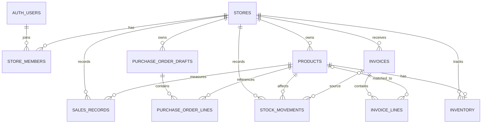

# DATABASE.md

## 1. Purpose and Scope

This document defines the proposed relational data model for
**ShelfSaathi**, based on the product requirements and the architecture.

- `PRD.md` is the source of truth for product scope, user journeys,
  roles, and required data.
- `ARCHITECTURE.md` defines the application structure, authentication
  model, and deployment approach.
- `DATABASE.md` defines persisted entities, relationships,
  constraints, indexes, ownership, and data lifecycle.

The MVP centres on invoice image upload, AI extraction, merchant review
and confirmation, stock updates, barcode/label generation, and
explainable reorder suggestions using available or clearly labelled
sample data.

Supplier Finder, Sales Booster, voice queries, real supplier ordering,
and other roadmap features must not be treated as live capabilities
merely because their future data could be modelled.

Where the product documents do not specify a field or policy, the
proposal below is an implementation recommendation to be confirmed
before production migration.

## 2. Database Technology

### Primary database

Use **PostgreSQL through Supabase**.

Reasons:

- Relational constraints and transactions are important for inventory consistency.
- Foreign keys and unique constraints help prevent duplicate processing and cross-record inconsistencies.
- PostgreSQL supports indexes and flexible query patterns without requiring a separate database.
- Supabase provides managed PostgreSQL and integrates with Supabase Auth.
- The schema can be managed through version-controlled migrations.

### Access pattern

- FastAPI is the trusted application layer for business data access.
- Use SQLAlchemy 2.x with Alembic migrations, as proposed in
  `ARCHITECTURE.md`, or choose a consistent psycopg repository
  approach before implementation.
- Do not mix multiple persistence patterns without a clear reason.
- Do not expose database credentials to the browser.
- If Supabase Row Level Security (RLS) is enabled, create and test
  explicit policies; do not assume RLS is configured automatically.

### Conventions

- Use `uuid` primary keys for application entities.
- Use `timestamptz` for timestamps and store them in UTC.
- Use `numeric` for money and quantities where fractional units are
  valid. Do not use floating-point types for financial values.
- Use `text` for names and descriptions unless a length limit is a
  real business rule.
- Use explicit foreign keys and check constraints for important
  invariants.
- Use `jsonb` only for provider metadata or structured data whose
  shape genuinely varies. Do not store core business entities as
  opaque JSON.
- Add `created_at` and `updated_at` where lifecycle tracking is
  useful.

## 3. Data Ownership Model

Every store-specific business record must belong to one store. Access
must be scoped by the authenticated user's verified store membership.

The proposed model supports one or more users per store, should the
product require staff access. If the MVP truly has only one user per
store, `store_members` is still a simple way to avoid hard-coding
ownership into every table, but its role vocabulary should remain
minimal.

### Ownership rules

- `stores` is the root business entity.
- `store_members` links authenticated users to stores.
- Catalogue products, inventory, invoices, stock movements, and
  purchase-order drafts are store-scoped.
- A user's identity comes from a validated Supabase Auth token, not
  from a client-supplied user ID.
- A `store_id` supplied by the browser is never sufficient proof of
  access.
- The backend checks membership and role before every protected
  operation.
- Database constraints and RLS, where enabled, provide defence in
  depth.

## 4. Entity Relationship Diagram

The diagram shows the proposed MVP entities. It deliberately excludes
roadmap-only supplier ordering, marketing content, and voice
conversation tables.

`AUTH_USERS` represents Supabase Auth users. It is managed by Supabase
and is not an application-owned table to recreate manually.

## 5. Tables and Columns

The following schema is a proposed minimum for the MVP. Exact fields
should be reconciled with the final `PRD.md` before creating migrations.

### 5.1 `stores`

One record per retail store/workspace.

| Column       | PostgreSQL type | Rules                               | Purpose            |
| ------------ | --------------- | ----------------------------------- | ------------------ |
| `id`         | `uuid`          | Primary key, default generated UUID | Store identifier   |
| `name`       | `text`          | Not null                            | Store display name |
| `created_at` | `timestamptz`   | Not null, default current timestamp | Creation time      |
| `updated_at` | `timestamptz`   | Not null, default current timestamp | Last update time   |

Do not add address, GST number, subscription tier, or other profile
fields unless required by the PRD.

### 5.2 `store_members`

Maps Supabase Auth users to stores and assigns a minimal role.

| Column       | PostgreSQL type | Rules                                         | Purpose                     |
| ------------ | --------------- | --------------------------------------------- | --------------------------- |
| `id`         | `uuid`          | Primary key, default generated UUID           | Membership identifier       |
| `store_id`   | `uuid`          | Not null, FK to `stores.id`, cascade delete   | Store                       |
| `user_id`    | `uuid`          | Not null, references Supabase Auth user ID    | Authenticated user          |
| `role`       | `text`          | Not null, constrained to `owner` or `staff`   | Store-level permission role |
| `created_at` | `timestamptz`   | Not null, default current timestamp           | Membership creation time    |

Constraints:

- Unique (`store_id`, `user_id`).
- Check constraint: `CHECK (role IN ('owner', 'staff'))`.
- Supported roles: `owner` (full store administration, member management, stock confirmation) and `staff` (operational intake, line review, barcode, draft creation).

The exact foreign-key reference to the Supabase-managed user table must
follow the selected Supabase schema and migration permissions. Do not
create a duplicate `auth.users` table.

### 5.3 `products`

The store's product catalogue.

| Column       | PostgreSQL type | Rules                                            | Purpose                             |
| ------------ | --------------- | ------------------------------------------------ | ----------------------------------- |
| `id`         | `uuid`          | Primary key, default generated UUID              | Product                             |
| `store_id`   | `uuid`          | Not null, FK to `stores.id`, cascade delete      | Owning store                        |
| `name`       | `text`          | Not null                                         | Product name                        |
| `brand`      | `text`          | Nullable                                         | Brand, if known                     |
| `barcode`    | `text`          | Nullable                                         | Manufacturer or generated barcode   |
| `unit`       | `text`          | Not null                                         | Base unit used for stock quantities |
| `pack_size`  | `numeric(12,3)` | Nullable, must be greater than zero when present | Pack quantity, where applicable     |
| `created_at` | `timestamptz`   | Not null, default current timestamp              | Creation time                       |
| `updated_at` | `timestamptz`   | Not null, default current timestamp              | Last update time                    |

Rules:

- Store-specific product names may repeat when the products are genuinely different.
- A non-null barcode should be unique within a store unless the product requirements explicitly support multiple catalogue entries sharing one barcode.
- Use a consistent unit vocabulary. Do not silently compare incompatible units.
- Barcode values should be stored as text to preserve leading zeros.
- Do not make external product data authoritative over merchant-confirmed values.

### 5.4 `inventory`

Stores the current on-hand quantity for a product in a store.

| Column             | PostgreSQL type | Rules                                                                                  | Purpose                     |
| ------------------ | --------------- | -------------------------------------------------------------------------------------- | --------------------------- |
| `id`               | `uuid`          | Primary key, default generated UUID                                                    | Inventory record identifier |
| `store_id`         | `uuid`          | Not null, FK to `stores.id`, cascade delete                                            | Owning store                |
| `product_id`       | `uuid`          | Not null, FK to `products.id`, cascade delete                                          | Product                     |
| `quantity_on_hand` | `numeric(14,3)` | Not null, default zero, check non-negative unless negative stock is explicitly allowed | Current quantity            |
| `updated_at`       | `timestamptz`   | Not null, default current timestamp                                                    | Last stock update           |

Constraints:

- Unique (`store_id`, `product_id`).
- Enforce that the product belongs to the same store as the inventory record. A composite foreign key or equivalent database constraint is preferred.
- Quantity precision must match the units supported by the product.
- Inventory is a current-state summary; `stock_movements` provides the audit trail.

Do not add reorder thresholds here unless the PRD establishes that
merchants configure them. If required, add the minimum necessary fields
in a reviewed schema change.

### 5.5 `invoices`

Tracks each uploaded supplier invoice and its processing/review
lifecycle.

| Column                  | PostgreSQL type | Rules                                                          | Purpose                             |
| ----------------------- | --------------- | -------------------------------------------------------------- | ----------------------------------- |
| `id`                    | `uuid`          | Primary key, default generated UUID                            | Invoice record                      |
| `store_id`              | `uuid`          | Not null, FK to `stores.id`, cascade delete                    | Owning store                        |
| `storage_key`           | `text`          | Not null, unique within the storage namespace                  | Private object-storage key          |
| `original_filename`     | `text`          | Nullable; sanitised display metadata only                      | Original filename for display       |
| `mime_type`             | `text`          | Not null; allowlisted image/PDF types only if PDF is supported | Validated content type              |
| `status`                | `text`          | Not null, constrained to allowed lifecycle values              | Processing/review status            |
| `extraction_provider`   | `text`          | Nullable                                                       | Provider identifier for diagnostics |
| `extraction_error_code` | `text`          | Nullable, safe internal error category                         | Processing failure category         |
| `confirmed_at`          | `timestamptz`   | Nullable                                                       | Confirmation time                   |
| `created_at`            | `timestamptz`   | Not null, default current timestamp                            | Upload creation time                |
| `updated_at`            | `timestamptz`   | Not null, default current timestamp                            | Last state change                   |

Suggested status vocabulary:

- `uploaded`
- `processing`
- `review_required`
- `confirmed`
- `failed`

Use only states required by the implemented workflow. State transitions
must be validated by the backend. A confirmed invoice must not be
processed a second time.

The original invoice image remains in private object storage. Do not
store image bytes directly in a database column.

### 5.6 `invoice_lines`

Stores extracted and merchant-reviewed invoice line items.

| Column            | PostgreSQL type | Rules                                         | Purpose                                     |
| ----------------- | --------------- | --------------------------------------------- | ------------------------------------------- |
| `id`              | `uuid`          | Primary key, default generated UUID           | Invoice line identifier                     |
| `invoice_id`      | `uuid`          | Not null, FK to `invoices.id`, cascade delete | Parent invoice                              |
| `line_number`     | `integer`       | Not null, positive                            | Source line ordering                        |
| `raw_description` | `text`          | Not null                                      | Extracted product description               |
| `product_id`      | `uuid`          | Nullable, FK to `products.id`                 | Matched catalogue product                   |
| `quantity`        | `numeric(14,3)` | Nullable, positive when present               | Extracted/reviewed quantity                 |
| `unit`            | `text`          | Nullable                                      | Extracted/reviewed unit                     |
| `unit_cost`       | `numeric(14,2)` | Nullable, non-negative when present           | Unit purchase cost, if extracted            |
| `line_total`      | `numeric(14,2)` | Nullable, non-negative when present           | Invoice line total, if extracted            |
| `confidence`      | `numeric(5,4)`  | Nullable, between 0 and 1                     | Extraction/matching confidence if available |
| `review_status`   | `text`          | Not null, constrained to approved values      | Review outcome                              |
| `created_at`      | `timestamptz`   | Not null, default current timestamp           | Creation time                               |
| `updated_at`      | `timestamptz`   | Not null, default current timestamp           | Last review/update time                     |

Suggested `review_status` values:

- `needs_review`
- `matched`
- `new_product`
- `ignored`

Only confirmed, valid lines should affect inventory. If an extracted
quantity or product identity is uncertain, require correction or
explicit merchant resolution.

Constraints:

- Unique (`invoice_id`, `line_number`).
- Ensure any `product_id` belongs to the same store as the parent invoice, enforced by backend checks and preferably a database constraint.
- If purchase quantity and stock quantity use different units, convert only through explicit, tested conversion rules. Do not infer conversions from text alone.

### 5.7 `stock_movements`

An append-oriented audit record for every inventory change.

| Column           | PostgreSQL type | Rules                                       | Purpose                                            |
| ---------------- | --------------- | ------------------------------------------- | -------------------------------------------------- |
| `id`             | `uuid`          | Primary key, default generated UUID         | Movement identifier                                |
| `store_id`       | `uuid`          | Not null, FK to `stores.id`, cascade delete | Owning store                                       |
| `product_id`     | `uuid`          | Not null, FK to `products.id`               | Affected product                                   |
| `invoice_id`     | `uuid`          | Nullable, FK to `invoices.id`               | Source invoice, when applicable                    |
| `movement_type`  | `text`          | Not null, constrained to approved values    | Reason for quantity change                         |
| `quantity_delta` | `numeric(14,3)` | Not null, non-zero                          | Signed stock change                                |
| `reference_key`  | `text`          | Nullable                                    | Idempotency/reference key for the source operation |
| `created_at`     | `timestamptz`   | Not null, default current timestamp         | Movement time                                      |

Rules:

- Positive `quantity_delta` increases stock; negative decreases it.
- The backend inserts the movement and updates `inventory` in the same transaction.
- Movement records should not be edited to correct history. Record a compensating movement instead.
- A unique idempotency constraint must prevent the same invoice line from being applied twice. Prefer a direct `invoice_line_id` foreign key if each movement corresponds to one invoice line; this is recommended for the MVP.

**Recommended adjustment to the table above:** include
`invoice_line_id uuid NULL` referencing `invoice_lines.id`, and enforce
uniqueness for the invoice-line stock application. This makes duplicate
confirmation prevention more precise than a free-form reference key.
Keep `reference_key` only if other source operations require it.

Suggested movement types, limited to implemented flows:

- `invoice_restock`
- `manual_adjustment`

Do not add sales deduction movements until the product imports or
records sales data.

### 5.8 `sales_records` (only if required for the MVP recommendation)

The architecture mentions product-level sales history as a possible
source for reorder suggestions. The project documentation says the
hackathon demo may use sample sales data. Persist this table only if the
application needs to import or retain sales observations; static demo
data may instead be seeded separately.

| Column          | PostgreSQL type | Rules                                            | Purpose                        |
| --------------- | --------------- | ------------------------------------------------ | ------------------------------ |
| `id`            | `uuid`          | Primary key, default generated UUID              | Sales record identifier        |
| `store_id`      | `uuid`          | Not null, FK to `stores.id`, cascade delete      | Owning store                   |
| `product_id`    | `uuid`          | Not null, FK to `products.id`                    | Sold product                   |
| `quantity_sold` | `numeric(14,3)` | Not null, greater than zero                      | Quantity sold                  |
| `sold_at`       | `timestamptz`   | Not null                                         | Time of sale                   |
| `source`        | `text`          | Not null, constrained to supported source values | Imported, manual, or demo data |
| `created_at`    | `timestamptz`   | Not null, default current timestamp              | Record creation time           |

Do not claim that payment totals alone establish product-level
quantities. Clearly identify seeded/demo records and exclude them from
real merchant analytics.

### 5.9 `purchase_order_drafts`

Stores editable drafts only. It does not represent an order sent to or
accepted by a supplier.

| Column       | PostgreSQL type | Rules                                                    | Purpose          |
| ------------ | --------------- | -------------------------------------------------------- | ---------------- |
| `id`         | `uuid`          | Primary key, default generated UUID                      | Draft identifier |
| `store_id`   | `uuid`          | Not null, FK to `stores.id`, cascade delete              | Owning store     |
| `status`     | `text`          | Not null, default `draft`, constrained to allowed values | Draft lifecycle  |
| `created_at` | `timestamptz`   | Not null, default current timestamp                      | Creation time    |
| `updated_at` | `timestamptz`   | Not null, default current timestamp                      | Last edit time   |

Suggested status: `draft` and, if the UI needs it, `cancelled`. Do not
add `sent`, `accepted`, or `fulfilled` until a real ordering integration
exists.

### 5.10 `purchase_order_lines`

Stores products and quantities in an editable draft.

| Column                    | PostgreSQL type | Rules                                                      | Purpose                      |
| ------------------------- | --------------- | ---------------------------------------------------------- | ---------------------------- |
| `id`                      | `uuid`          | Primary key, default generated UUID                        | Draft line identifier        |
| `purchase_order_draft_id` | `uuid`          | Not null, FK to `purchase_order_drafts.id`, cascade delete | Parent draft                 |
| `product_id`              | `uuid`          | Not null, FK to `products.id`                              | Requested product            |
| `quantity`                | `numeric(14,3)` | Not null, greater than zero                                | Requested quantity           |
| `unit_cost`               | `numeric(14,2)` | Nullable, non-negative                                     | Estimated cost, if available |
| `created_at`              | `timestamptz`   | Not null, default current timestamp                        | Creation time                |
| `updated_at`              | `timestamptz`   | Not null, default current timestamp                        | Last edit time               |

Ensure the product belongs to the same store as the parent draft. Do not
imply that a nullable estimated cost is a verified supplier price.

## 6. Constraints and Validation

### 6.1 Database-level constraints

Enforce invariants at the database level wherever practical:

- Primary keys on all application-owned tables.
- Foreign keys for all entity relationships.
- Unique store membership per (`store_id`, `user_id`).
- Unique product barcode per store where barcode is non-null.
- Unique inventory row per (`store_id`, `product_id`).
- Unique invoice line number per (`invoice_id`, `line_number`).
- Non-negative money values where applicable.
- Positive quantities for invoice and purchase-order lines when
  confirmed.
- Non-zero `quantity_delta` for stock movements.
- Confidence values between zero and one.
- Approved values for lifecycle statuses and movement types.
- Prevent duplicate inventory application from the same invoice line.

### 6.2 Application-level validation

The backend must also validate:

- The user is authorised for the store.
- All related products belong to the invoice/draft's store.
- Units are compatible before arithmetic.
- A confirmed invoice is not confirmed again.
- Invoice state transitions are valid.
- Extracted fields are schema-valid before saving.
- A product match is not accepted solely because of a fuzzy similarity score.
- Uploads meet size, type, and content validation rules.
- Reorder suggestions have enough data for their stated explanation.
- Demo/sample data is not represented as real merchant history.

A database constraint cannot replace store-level authorisation.

## 7. Indexes Based on Expected Queries

Create indexes for the queries used by the MVP, then verify them against
real query plans as usage grows.

| Index                                       | Columns                                                           | Reason                                                              |
| ------------------------------------------- | ----------------------------------------------------------------- | ------------------------------------------------------------------- |
| `store_members_store_user_uq`               | (`store_id`, `user_id`) unique                                    | Resolve membership and prevent duplicate memberships                |
| `store_members_user_idx`                    | (`user_id`)                                                       | Find stores available to an authenticated user                      |
| `products_store_name_idx`                   | (`store_id`, `name`)                                              | List/search products within a store                                 |
| `products_store_barcode_uq`                 | (`store_id`, `barcode`) unique, partial where barcode is not null | Barcode lookup and duplicate prevention                             |
| `inventory_store_product_uq`                | (`store_id`, `product_id`) unique                                 | Read or update current stock for a product                          |
| `invoices_store_created_idx`                | (`store_id`, `created_at` descending)                             | List recent invoices for a store                                    |
| `invoices_store_status_idx`                 | (`store_id`, `status`)                                            | Find invoices awaiting review or processing                         |
| `invoice_lines_invoice_line_uq`             | (`invoice_id`, `line_number`) unique                              | Fetch invoice lines in source order                                 |
| `invoice_lines_product_idx`                 | (`product_id`)                                                    | Find invoice-line references to a product when needed               |
| `stock_movements_store_product_created_idx` | (`store_id`, `product_id`, `created_at` descending)               | Read stock history for a product                                    |
| `stock_movements_invoice_line_uq`           | (`invoice_line_id`) unique, partial where not null                | Prevent applying one invoice line more than once                    |
| `sales_records_store_product_time_idx`      | (`store_id`, `product_id`, `sold_at` descending)                  | Compute recent product-level sales rates if sales data is persisted |
| `purchase_order_drafts_store_created_idx`   | (`store_id`, `created_at` descending)                             | List recent drafts                                                  |
| `purchase_order_lines_draft_idx`            | (`purchase_order_draft_id`)                                       | Fetch draft lines                                                   |

Do not create every possible index speculatively. Foreign-key columns
used for joins or deletion checks should be indexed when the database
does not create a suitable index automatically. Review index usage after
pilot traffic; each additional index increases write cost and storage.

## 8. Authorization and Row-Level Security

### 8.1 Application authorization

FastAPI must enforce authentication and store membership on every
protected operation. A valid Supabase token identifies the user but does
not automatically grant access to any store.

### 8.2 RLS strategy

Choose one of these strategies deliberately:

**Option A: Backend-only database access (simplest MVP)**

- The browser calls FastAPI for all business data.
- FastAPI uses a server-side database connection.
- Direct browser access to business tables is not enabled.
- Database credentials are kept on the backend.
- Application queries always include authorised store scope.
- Database permissions are least-privilege where practical.

**Option B: Supabase client access with RLS**

- Use only if the frontend must query selected tables directly.
- Enable RLS on every exposed business table.
- Write policies based on validated store membership.
- Test select, insert, update, and delete paths, including cross-store attempts.
- Keep service-role credentials server-side; service-role access can bypass RLS.

For the proposed architecture, **Option A is the default** because
FastAPI is the central business API. RLS may still be enabled as defence
in depth, but do not depend on it without explicit policies and tests.
If using a privileged server connection that bypasses RLS,
application-level store checks are mandatory.

### 8.3 Store-isolation requirements

- A user from Store A must not read or mutate Store B's products,
  invoices, stock, or drafts.
- Do not accept user identity from request payloads.
- Validate store ownership for parent and child records.
- Ensure a product referenced by an invoice line or draft belongs to
  the same store.
- Test attempts to guess UUIDs from other stores.
- Use generic not-found/forbidden responses where revealing resource
  existence would be inappropriate.

## 9. Sensitive-Data Handling and Retention

### 9.1 Sensitive data

Invoice images may contain supplier names, addresses, phone numbers, tax
identifiers, prices, and purchase history. Treat them as private
business data.

- Store invoice images in a private bucket.
- Keep object-storage keys in the database, not public URLs.
- Use short-lived signed URLs only when direct access is required.
- Authorise every upload, read, and deletion.
- Do not log full invoice content, image bytes, access tokens, or API
  keys.
- Send only the minimum necessary image/content to the AI provider.
- Confirm the AI provider's data-use and retention terms before
  processing real merchant invoices.
- Restrict database and storage access to staff who need it.
- Define document retention and deletion rules before a production
  pilot.

### 9.2 Data minimisation

Do not collect personal data that is not needed for the defined
workflow. Avoid storing full AI prompts and raw provider responses
indefinitely. Persist only extracted fields, review results,
provider/status metadata, and diagnostic details required by the
application.

If raw AI output is needed for debugging, limit access and retention,
and remove sensitive fields where practical.

### 9.3 Deletion and auditability

- Deleting a store must follow a deliberate retention policy; do not
  cascade-delete operational records unintentionally.
- If a store is deactivated rather than erased, document the
  lifecycle.
- Stock movements are audit records. Correct mistakes through
  compensating movements instead of silently rewriting history.
- Ensure deletion of an invoice image does not leave the UI implying
  that the source document remains available.
- Retention obligations for invoices and tax records must be confirmed
  with the product owner; they are not specified in the available
  requirements.

## 10. Migration Strategy

Use Alembic migrations stored in version control.

Rules:

1. Every schema change is a reviewed migration.
2. Do not change production schema manually.
3. Test migrations against a clean database and a representative existing database.
4. Use backward-compatible changes when possible.
5. Back up data before risky migrations.
6. Avoid destructive migrations in the same release that removes application support for the old schema unless the deployment plan explicitly allows it.
7. Add constraints after existing data has been validated and cleaned where necessary.
8. Document any manual migration or backfill.
9. Do not put real secrets or production data into migration files.
10. Ensure the application and migration tool use the intended environment.

### Initial migration order

A sensible order is:

1. `stores`
2. `store_members`
3. `products`
4. `inventory`
5. `invoices`
6. `invoice_lines`
7. `stock_movements`
8. `purchase_order_drafts`
9. `purchase_order_lines`
10. `sales_records`, only if persisted product-level sales data is required

Because `stock_movements` references `invoice_lines`, create those
tables in dependency order even if the list above is adjusted during
implementation.

## 11. Seed Data Strategy

Use seed data only for local development, automated tests, and a clearly
labelled hackathon/demo environment.

### Allowed seed data

- A synthetic store and test user/membership.
- Representative products with fake barcodes or clearly designated
  test identifiers.
- Synthetic invoices and invoice lines.
- Sample stock levels and stock movements.
- Sample product-level sales records for the reorder demonstration, if
  needed.

### Rules

- Never seed production with shared default passwords or publicly
  known credentials.
- Never use a real merchant's invoice or purchase history as generic
  demo data without permission.
- Make sample/demo data clearly identifiable.
- Ensure demo data cannot be mistaken for live supplier availability
  or real sales history.
- Keep seeds deterministic so automated tests can rely on known
  states.
- Avoid duplicating large catalogue datasets in the database if a
  small fixture is enough to test the workflow.

## 12. Backup and Recovery

### MVP requirements

- Confirm which backup and point-in-time recovery capabilities are
  included in the selected Supabase plan.
- Define who can access backups and protect those credentials.
- Document how to export essential business tables and how to restore
  them.
- Test restoration into a separate environment before relying on
  backups.
- Ensure private invoice storage has a separate backup/retention plan;
  a database backup alone does not preserve the image objects.
- Keep schema migrations in version control so the database structure
  can be recreated.
- Do not claim a recovery point objective (RPO) or recovery time
  objective (RTO) until the chosen plan and restore procedure have
  been tested.

### Recovery considerations

A restore must keep database references and stored invoice objects
consistent. If restoring only the database, verify that every referenced
storage object still exists. If restoring only object storage, ensure
orphaned objects are handled safely.

For the hackathon prototype, a documented export and restore procedure
may be sufficient. Before real merchant usage, test a complete recovery
of both PostgreSQL data and required private files.

## 13. Query Patterns Supported by This Schema

The schema is intended to support these core queries:

1.  Resolve the authenticated user's store membership.
2.  List a store's products and look up a product by barcode.
3.  Read the current stock quantity for a product.
4.  Upload an invoice and retrieve its extraction/review state.
5.  List invoice lines in their original order.
6.  Match extracted invoice lines to store catalogue products.
7.  Confirm an invoice and atomically update inventory.
8.  Read stock movement history for a product.
9.  Calculate reorder suggestions from available stock and explicitly
    supported sales data.
10. Create, edit, and retrieve an editable purchase-order draft.

The schema does not establish live supplier availability, live
purchase-order delivery status, sales from payment totals alone, or the
data model for roadmap-only marketing and voice features.

## 14. Decisions to Confirm Before Production

1.  The exact role names and whether staff accounts are in MVP scope.
2.  Whether invoice uploads support images only or PDF files as well.
3.  Which invoice fields must be retained for merchant workflows and
    compliance.
4.  Which units and pack-size conversions are supported.
5.  Whether the MVP stores product-level sales history or uses isolated
    demo fixtures.
6.  Whether generated barcodes must be unique only within a store or
    across a broader namespace.
7.  Whether any supplier data is persisted in the live MVP or only shown
    as seeded demo data.
8.  The retention and deletion policy for invoice images and extracted
    records.
9.  The chosen Supabase connection mode and whether RLS is used as
    defence in depth.
10. Backup, recovery, and restore expectations before onboarding real
    stores.

## 15. Definition of Done

The database design is ready for implementation when:

- All tables map to approved MVP workflows.
- Primary keys, foreign keys, uniqueness, and check constraints are defined.
- Store ownership and cross-store isolation are enforced and tested.
- Invoice confirmation and stock updates are transactional and idempotent.
- Stock movements provide a traceable record of quantity changes.
- Money and quantity types preserve required precision.
- Indexes correspond to real MVP queries.
- Private invoice objects are not publicly accessible.
- Migrations are version controlled and tested.
- Seed data is synthetic and clearly separated from production data.
- Backup and restore procedures cover both database rows and required stored files.
- Roadmap-only features do not introduce unnecessary tables.
